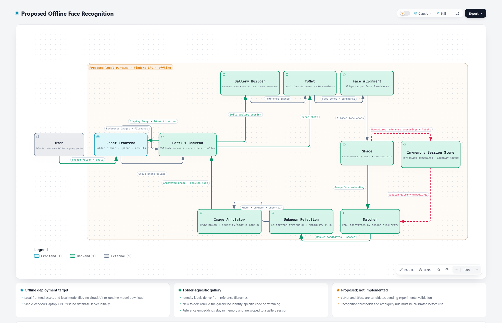

# Architecture: Proposed Offline Face Recognition

> **Status: proposed, not implemented.** This diagram documents the intended modular-monolith design. YuNet and SFace are selected candidates pending experimental validation; this document does not claim benchmark results or working application features.

## Diagram

Open the image above to view the **interactive standalone Archify diagram**. The proposed Windows CPU runtime loads the built frontend assets and ONNX model files locally; it makes no external network requests at runtime, including cloud API calls or model downloads.

## Components and responsibilities

| Component | Responsibility |
|---|---|
| **React frontend** | Lets the user select a reference folder and group photo, transfers reference image files with their original filenames, and displays both the annotated photo and a separate identification list. |
| **FastAPI backend** | Validates requests and coordinates gallery creation and group-photo recognition. Recognition decisions remain in the engine components rather than the UI. |
| **Gallery Builder** | Validates reference images, derives each identity label from its filename, and creates a gallery for the current session. Invalid or unreadable images and references containing zero or multiple faces are rejected and reported. |
| **YuNet (candidate)** | Detects faces and landmarks in reference images and the group photo. It is a local CPU candidate pending experimental validation. |
| **Face Alignment** | Uses detected landmarks to align reference and group-photo face crops before embedding extraction. |
| **SFace (candidate)** | Extracts normalized face embeddings from aligned crops. It is a local CPU candidate pending experimental validation. |
| **In-memory Session Store** | Keeps a gallery-session record in process memory: a session ID, identity-to-normalized-embedding mappings, creation time, and expiry. It is not a database server. |
| **Matcher** | Ranks candidate identities for each group-photo face using cosine similarity against the selected session’s reference embeddings. |
| **Unknown Rejection** | Makes the final decision using an experimentally calibrated acceptance threshold and ambiguity rule: **known** when the top candidate clears the threshold and is sufficiently separated from the runner-up; **unknown** when no candidate clears the threshold; **uncertain** when the top score or candidate separation falls in the ambiguity region. Numerical values remain unresolved until calibration. |
| **Image Annotator** | Draws bounding boxes and the resulting identity/status labels on a copy of the group photo. |

## Data flow

1. The user selects a reference folder in React. The browser supplies the image files and filenames; React uploads them to FastAPI.
2. FastAPI validates the request and asks the Gallery Builder to create a gallery. The Gallery Builder obtains each identity label from its filename and rejects/reports references with zero or multiple faces, so another folder can be used without identity-specific code or retraining.
3. For each valid reference, YuNet detects a face and landmarks, Face Alignment aligns its crop, and SFace extracts a normalized embedding. The In-memory Session Store holds a session ID, identity-to-embedding mappings, creation time, and expiry.
4. The user uploads a group photo. FastAPI routes it through YuNet, Face Alignment, and SFace to detect and embed each usable group-photo face.
5. The Matcher compares each query embedding against the embeddings from that gallery session and ranks candidates by cosine similarity.
6. Unknown Rejection applies the calibrated acceptance threshold and ambiguity rule: known for a qualifying, sufficiently separated top candidate; unknown when no candidate qualifies; uncertain when the score or separation is ambiguous. No numeric threshold is specified before experiments.
7. The Image Annotator draws the face boxes and outcomes. FastAPI returns the annotated image and a separate results list to React for display.

No identity-specific model training is part of this flow. Selecting a different reference folder rebuilds the session gallery from the supplied filenames and images.

## Trade-offs

- **Chosen:** a modular monolith with separate vision and matching responsibilities. It keeps local setup and debugging manageable while allowing the recognition engine to be tested independently of React and FastAPI.
- **Chosen:** CPU-first local inference with local model files and frontend assets. This supports offline runtime and avoids cloud services and runtime downloads.
- **Chosen:** in-memory embeddings scoped to a gallery session, with no database server or persistent cache initially. This limits biometric retention and suits the small initial gallery; it also means a process restart requires rebuilding the gallery.
- **Given up:** persistent caching and approximate-nearest-neighbor infrastructure such as FAISS. They add storage and operational complexity without a demonstrated need for the initial gallery size.
- **Unresolved:** YuNet/SFace accuracy and Windows performance, face-size and detection behavior on group photos, and thresholds for false-match versus unknown/uncertain decisions. These require experiments; the diagram does not present them as validated.

## Privacy notes

Reference embeddings are biometric data. The proposed design keeps them in process memory, scopes them to a gallery session, and avoids persisting reference photos or embeddings. Implementation should also avoid logging images, filenames, face crops, and embeddings; bind the service to localhost; release session memory when no longer needed; and keep personal photos and embeddings out of the public repository. These are design requirements, not implemented controls.
